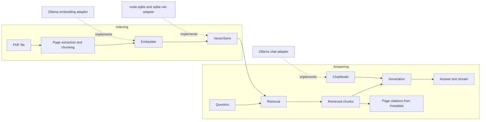

# Architecture

The application has two workflows. Ingestion extracts text per PDF page, creates page-aware text chunks, embeds them, and stores them. Answering embeds the question, retrieves relevant chunks, streams a response from a replaceable chat model, and returns citations separately from generated text.

## Decisions

- TypeScript uses ES modules and targets Node.js 24 or newer.
- `Embedder`, `VectorStore`, and `ChatModel` are contracts so provider and storage implementations can be replaced independently. The Ollama adapters use the built-in `fetch` (no client library) and share `src/ollama/ollama-http.ts` for timeouts, NDJSON streaming, and user-facing error messages.
- **Extraction** uses `pdfjs-dist` page by page, keeping line breaks and joining words hyphenated across lines. Pages without text are kept empty and reported as possibly scanned; a PDF with no text at all is rejected. OCR is not included.
- **Chunking** never crosses a page boundary, so every chunk has exactly one page to cite. Text is split into sentences (words for very long sentences) and packed greedily up to the chunk size; each chunk starts with the trailing sentences of the previous one, up to the overlap. Sizes are in approximate tokens (4 characters per token), with no tokenizer dependency.
- **Embeddings** default to `bge-m3` because documents are mostly in Spanish and it is multilingual; it needs no query/document prefixes. Changing the embedding model requires re-ingesting: documents record the model, and searches refuse documents indexed with another one.
- **Storage** uses the built-in `node:sqlite` plus the `sqlite-vec` extension: regular tables for documents and chunks, and a `vec0` table (cosine distance, created on first write with the model's dimension) sharing the chunk rowid. Search is exact KNN, optionally filtered by document. No server is needed.
- **Re-ingestion**: a document id is the SHA-256 of the file. Same content and settings → skipped. Otherwise the document, and any earlier document from the same path, is replaced in one transaction, so data is never duplicated.
- **Generation** uses a Spanish system prompt (small models follow it more consistently in the documents' language) that restricts answers to the retrieved chunks, asks for `[p. N]` after each fact, and requires the exact reply `No lo sé: el documento no contiene esa información.` when the answer is missing. `temperature` is 0 and `num_ctx` is set explicitly, because Ollama silently truncates prompts that exceed it.
- **Citations** come from retrieved chunk metadata, never from model text alone: if the answer cites some retrieved pages as `[p. N]`, only those are shown; otherwise all retrieved pages are. A "don't know" answer has no citations.
- Timeouts are inactivity timeouts: a long streamed answer is fine as long as tokens keep arriving.
- Defaults are conservative for an 8 GB, CPU-only machine: 450 tokens per chunk, 75 tokens of overlap, `topK` 3. The default chat model is `llama3.2:3b`; an answer takes roughly 30–60 s. `llama3.2:1b` is faster but, in manual tests, often answered "I don't know" when the answer was present.
- Initial configuration keys use the `PDF_OLLAMA_` prefix; `OLLAMA_BASE_URL` follows Ollama's common environment variable name.
- `evals/` is reserved for deterministic retrieval/answer checks and manual review; it is not implemented yet.

## Environment variables

| Variable | Default | Purpose |
| --- | --- | --- |
| `PDF_OLLAMA_EMBEDDING_MODEL` | `bge-m3` | Embedding model name |
| `PDF_OLLAMA_CHAT_MODEL` | `llama3.2:3b` | Chat model name |
| `PDF_OLLAMA_CHUNK_SIZE` | `450` | Target chunk size in tokens |
| `PDF_OLLAMA_CHUNK_OVERLAP` | `75` | Chunk overlap in tokens (must be smaller than the size) |
| `PDF_OLLAMA_EMBEDDING_BATCH_SIZE` | `16` | Chunks per embedding request |
| `PDF_OLLAMA_TOP_K` | `3` | Number of retrieved chunks |
| `PDF_OLLAMA_TEMPERATURE` | `0` | Chat sampling temperature |
| `PDF_OLLAMA_NUM_CTX` | `4096` | Chat context window in tokens |
| `OLLAMA_BASE_URL` | `http://localhost:11434` | Ollama server URL |
| `PDF_OLLAMA_TIMEOUT_MS` | `120000` | Maximum time without a response from Ollama |
| `PDF_OLLAMA_DATA_DIR` | `./data` | Local application data directory |
| `PDF_OLLAMA_DATABASE_FILE` | `<data dir>/pdf-ollama.db` | SQLite database file |

Invalid numeric values stop the CLI with a message naming the variable.
